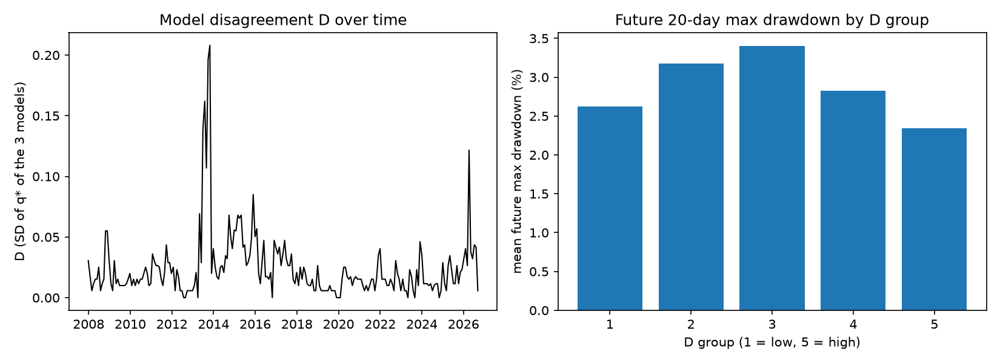

# When Tail Risk Models Disagree: HS vs FHS vs Student-t

**Author:** Chunyang Tian
**Date:** October 2026
**Goal:** Use 3 Expected Shortfall (ES) models to decide how much NVDA I can add to a normal portfolio, and check if the disagreement between the models tells us anything about the risk in the next month.

## Purpose & Outcome

Variance treat a big up day and a big down day the same, so in this project I use Expected Shortfall (ES, also called CVaR) as the risk. ES is the average loss in the worst 5% of cases.

To compute ES we need a model, and there are many models that all look reasonable. I pick 3 common ones:

- **Historical Simulation (HS):** use the past 3 years as it is.
- **Filtered Historical Simulation (FHS):** same as HS, but scale the past shocks by today's volatility (EWMA).
- **Student-t Monte Carlo (t-MC):** fit a fat-tail Student-t and simulate.

Each model decides the NVDA weight q\*, and they often don't agree. Usually people just pick one model. Here I want to ask a different question: **when the 3 models disagree a lot, is the next month more risky?**

I also check a more practical question: **if I really hold each model's q\*, which model kept the risk it promised?**

## How it works

1. Download daily prices from Yahoo Finance (2005 to today). Base portfolio is SPY 30%, QQQ 20%, TLT 20%, GLD 15%, Cash 15%. The risky stock is NVDA.
2. Every month (21 trading days), only use the past 750 days (about 3 years) to fit each model. So the model never see the future.
3. For each model, find q\* = the biggest NVDA weight where the 10-day 95% ES is at most 15% higher than the ES without NVDA:

   q\* = max { q : ES(q) ≤ 1.15 × ES(0) }

4. Disagreement D = standard deviation of the 3 q\*. If all models agree, D = 0.
5. Check what really happen: the max drawdown of a fixed 90% base + 10% NVDA portfolio in the next 20 days.
6. Sort the months into 5 groups by D, compare the future drawdown, then run a regression with past 20-day volatility as a control (Newey-West t values).
7. Backtest: hold each model's q\* for the next 10 days, and compare the real loss with the model's own 95% VaR and ES. I also try a simple rule: every month take the smallest q\* of the 3 models.

The control is important. D could be higher when the market is volatile, and a volatile market also has bigger drawdown, so D could just be volatility with another name.

## Results

Data from 2005-01-04 to 2026-10-16. This gives 225 monthly decisions, from 2007-12 to 2026-09.

### Hand check on one date

On 2020-02-21, just before the COVID crash:

```
model   ES(q=0)  ES(q=0.05)  ES(q=0.10)  ES(q=0.20)  limit    q*
HS      3.01%    3.51%       4.08%       5.34%       3.46%   0.04
FHS     1.74%    2.31%       3.05%       4.69%       2.00%   0.02
t-MC    2.41%    2.78%       3.27%       4.47%       2.77%   0.04
base vol today (EWMA) = 4.9%, average of past 3 years = 7.0%
```

Same date, same data, but FHS only allows 2% NVDA while the other two allow 4%. The base portfolio was very calm that day (4.9% vs 7.0% on average). FHS uses today's volatility, so its ES without NVDA is small (1.74%), and adding NVDA pushes the ES over the limit very fast.

### The 3 models really disagree

| Model | mean q\* | min | max | lowest of the 3 |
|---|---|---|---|---|
| HS | 0.084 | 0.03 | 0.24 | 27% of months |
| FHS | 0.084 | 0.01 | 0.43 | 35% of months |
| t-MC | 0.067 | 0.04 | 0.14 | 38% of months |

The 3 models give exactly the same q\* in only 3% of months, and the average D is 0.024. So which model you pick really changes the position size. FHS moves the most (from 0.01 to 0.43).

### Future drawdown by D group



| D group | mean D | mean past 20-day vol | mean future 20-day max drawdown | months |
|---|---|---|---|---|
| 1 (low) | 0.0048 | 9.9% | 2.62% | 45 |
| 2 | 0.0112 | 11.4% | 3.18% | 45 |
| 3 | 0.0168 | 12.1% | 3.40% | 45 |
| 4 | 0.0266 | 12.3% | 2.83% | 45 |
| 5 (high) | 0.0620 | 11.3% | 2.34% | 45 |

This is not what I expected. The high D group has the **smallest** future drawdown, and the shape is like a hill, not going up. Also D is not volatility with another name: the correlation between D and past 20-day vol is only -0.003. Past vol is the thing that really relates to future drawdown (correlation 0.402).

Regression of future drawdown (t values use Newey-West):

```
D           t(D) = -2.32                      R2 = 0.010
vol20       t(vol20) = 4.11                   R2 = 0.162
D + vol20   t(D) = -2.51, t(vol20) = 4.05     R2 = 0.172
```

### Check with fewer months

The 5 months with the highest D:

```
            q_HS  q_FHS  q_tMC      D  vol20  future_mdd
2013-10-28  0.08   0.43   0.06  0.208  0.078       0.018
2013-09-27  0.08   0.41   0.06  0.197  0.072       0.017
2013-07-30  0.08   0.35   0.06  0.162  0.067       0.014
2013-06-28  0.08   0.31   0.06  0.139  0.113       0.007
2026-04-09  0.08   0.28   0.06  0.122  0.174       0.012
```

4 of the 5 are in 2013, one after another, and in all of them FHS is the model far away from the other two. So I check if the result only comes from these few months:

```
without 2013: t(D) = -1.93 , t(vol20) = 4.02
use D rank:   t(D_rank) = -1.68 , t(vol20) = 4.16
model far from the other two in group 5: {'q_HS': 12, 'q_FHS': 28, 'q_tMC': 5}
```

With all months t(D) is -2.51, but when I remove 2013, or use the rank of D (so a few huge D can't dominate), t(D) is not significant anymore. And in the high D group, FHS is the one far from the other two in 28 of 45 months. My guess is that FHS uses today's volatility of each asset, so when NVDA is much calmer today than in the past 3 years (like in 2013), FHS allows a lot more NVDA.

So the 3 models really disagree, but high disagreement did not warn about a bigger drawdown in the next month. The small negative link mostly comes from a few months in 2013, so I don't think it is real.

### Backtest: hold each model's q\* for 10 days

Every month I hold the q\* of each model for the next 10 days and record the real loss. If a model is right, the real loss should be bigger than its 95% VaR in about 5% of months (about 11 of 225), and the average of the worst 5% real losses should be close to the ES it predicted.

| Model | mean q\* | mean 10-day return | model's ES (mean) | real ES (worst 5%) | worst 10-day loss | VaR breaks | p-value |
|---|---|---|---|---|---|---|---|
| HS | 0.084 | 0.53% | 4.64% | 5.25% | 12.66% | 16 (7.1%) | 0.165 |
| FHS | 0.084 | 0.54% | 4.23% | 5.32% | 13.60% | 16 (7.1%) | 0.165 |
| t-MC | 0.067 | 0.49% | 4.24% | 5.13% | 13.29% | 13 (5.8%) | 0.54 |
| min rule | 0.057 | 0.50% | - | 5.02% | 12.66% | - | - |

(p-value is a binomial test: is the VaR break rate far from 5%?)

1. All 3 models are a bit too optimistic. The real ES is 5.1% to 5.3%, but the models predicted only 4.2% to 4.6%. They also break their VaR a bit more than 11 times. But all p-values are above 0.16, so I can't say any model is clearly wrong.
2. FHS is the most optimistic. It predicts the lowest ES (4.23%) but has the highest real ES (5.32%) and the worst single loss (13.60%). FHS is also the model that makes most of the big disagreement, so the big positions from FHS are the ones to be careful with.
3. The min rule (take the smallest q\* every month) has the lowest real ES (5.02%), and the return is only a little lower (0.50% vs 0.53% for HS every 10 days). It is like a cheap insurance, but the improvement is small.

So if I use ES to decide a position, I would not trust one model alone, especially FHS. Taking the most conservative of a few models is a simple way to protect the tail.

## Limitations

1. Only 3 models and 1 risky stock (NVDA), so D is noisy.
2. 225 monthly points is not a lot for a tail risk study, and the highest D months are clustered in time.
3. Only one control (past 20-day volatility). VIX, correlation or the ES level itself are not controlled.
4. FHS and t-MC use 5000 random scenarios and q\* is on a 0.01 grid, so part of D is just simulation noise and rounding. Many months have the same D, so which group a month goes into at the boundary is a bit random (the middle groups can change a little).
5. The 5 groups use the whole sample at once (in-sample). A real warning signal needs a walk-forward test.
6. In the backtest, the real ES is the average of only the worst 12 months, so it is noisy. The differences between the models are small and could change with other stocks or other years.

## Future work

- Check my guess about FHS: compare NVDA's volatility today with the base portfolio's volatility today, and see if it explains q\* of FHS.
- Add a model that is very different from these 3, like EVT or my HMM regime model, and more stocks.
- Walk-forward out-of-sample test.
- Run the backtest on more stocks, so there are more bad months to compare the models and the min rule.

## How to run

```bash
pip install -r requirements.txt
python cvar_disagreement.py
```

The script print the hand check, q\* of each model, the 5 group table, the correlation, the regression, the check and the backtest. It also save `results.csv` (one row per month), `backtest.csv` (one row per month and model) and `figure.png`.
